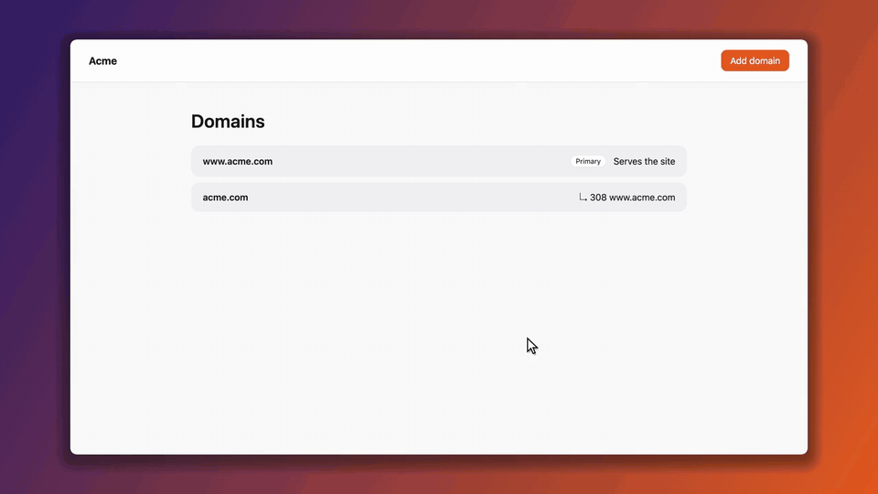
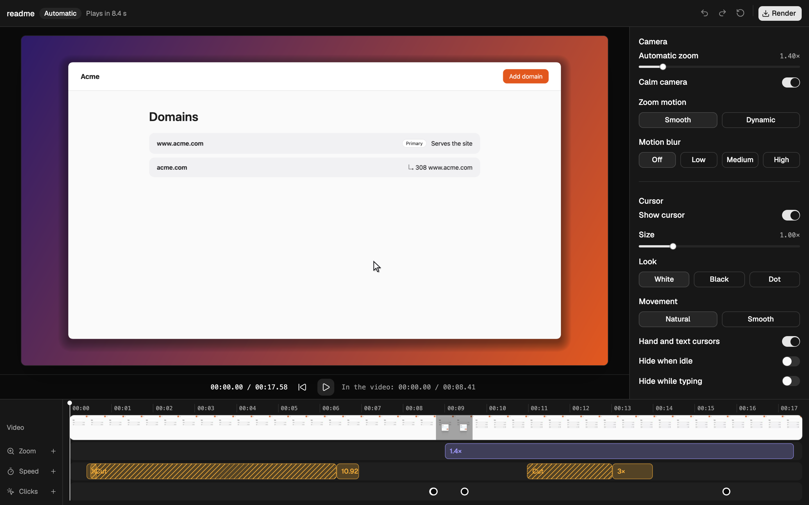

# reel

**Your AI agent clicks through your real app. You get a polished demo video.**

Ask your coding agent to show a feature working. It drives the browser with [agent-browser](https://github.com/vercel-labs/agent-browser) while reel records, then reel adds the zooms, the cursor and the click effects, and cuts the waiting. Nothing is staged, because every click really happened in your app.



*An agent recorded this take with no editing by hand. It took 17.6 s to record and plays in 8.4 s.*

## Install

```bash
curl -fsSL https://raw.githubusercontent.com/alexandrebodin/reel/main/install.sh | sh
```

This installs `reel` to `~/.reel/bin` and links the skill for Claude Code and any agent that reads `~/.agents/skills`. Run it again to update.

reel also needs two tools, and the installer tells you if either is missing:

```bash
brew install ffmpeg
```

```bash
npm install -g agent-browser && agent-browser install
```

Builds are available for macOS (Apple silicon and Intel) and Linux x86_64.

## Record a demo

Ask your agent:

> Record a demo of the domain redirects flow on localhost:3000

The agent opens your app, rehearses the flow, puts the app back where it started and records it for real. It looks over the result and hands you an MP4.

There's nothing to set up per project, and everything runs on your machine.

## What you get

- **Sharp video:** the browser records at 2x, so text stays crisp through padding and zoom.
- **A camera that keeps up:** it moves in on what matters and holds still through plain clicks.
- **A smooth cursor:** recordings don't capture a pointer, so reel draws one, with click effects and the right hand or text shape.
- **No waiting:** the agent's thinking time is cut, slow loads are sped up, and cuts crossfade.
- **Your look:** set the background, padding, shadow, corners, cursor style and motion blur.
- **A fast re-take:** every take also saves a `replay.json` that re-records the same flow with no agent.

## Change a finished demo

| You want | Run | Records again? |
| --- | --- | --- |
| A different look | `reel --render out/demo/recording.json out/demo/new.mp4 --style background.fill=#101820` | No |
| To tweak zooms, speed or cuts by hand | `reel edit out/demo/recording.json` | No |
| The same flow after your app changed | `reel out/demo/replay.json` | Yes, with no agent |
| A different flow | Ask your agent for a new take | Yes |

`replay.json` contains the text that was typed, so check it before sharing it. It leaves out passwords.

## Edit by hand

Editing is optional. `reel edit` opens a timeline where you can drag zooms, speed changes and cuts, then render. It also opens any existing MP4.



The editor opens in your browser. To get the desktop app, which `reel edit` then prefers, build it from a clone of this repo with Rust and pnpm installed:

```bash
pnpm --dir app install && pnpm --dir app tauri build --bundles app
```

## Drive it yourself

The agent uses ordinary commands, so you can run the same ones:

```bash
reel rec open --session demo http://localhost:3000
reel rec start --session demo
agent-browser --session demo snapshot -i
agent-browser --session demo click @e1
reel rec type --session demo "#hostname" "shop.acme.com"
reel rec hold --session demo 2000
reel rec cut --session demo --last 1
reel rec stop --session demo
```

- `rec open` starts the browser at 2x. Add `--state auth.json` to start signed in with a saved agent-browser state file.
- `rec type` types visibly, one key at a time. Don't use it for real passwords: sign in before `rec start`.
- `rec hold` keeps something on screen for the viewer to read. Other waiting is trimmed.
- `rec cut` takes the last actions out of the video, once you've undone them in the app.
- `rec stop` renders the video to `out/demo/`, which takes about 3 seconds per second of video.

To script a demo instead, clone the repo and run the [sample](examples/domains/demo.json):

```bash
reel examples/domains/demo.json out/sample.mp4
```

## Style options

Pass these to `reel rec start` or `reel --render` as `--style key=value`. The defaults are a good start.

| Key | Values |
| --- | --- |
| `zoom.level` | 1 to 8, default 1.4. 1 never zooms |
| `zoom.animation` | `smooth`, `dynamic` |
| `zoom.calm` | `true`, `false`. On by default for agent takes |
| `motion_blur` | `off`, `low`, `medium`, `high`. Renders about 3 times slower or more |
| `cursor.show`, `cursor.adaptive`, `cursor.hide_when_idle`, `cursor.hide_when_typing` | `true`, `false` |
| `cursor.size` | 0.25 to 8 |
| `cursor.style` | `white_arrow`, `black_arrow`, `dot` |
| `cursor.motion` | `natural`, `smooth` |
| `clicks.press`, `clicks.ripple` | `true`, `false` |
| `clicks.color` | `#rrggbb` or a name such as `blue` |
| `clicks.style` | `filled`, `outline` |
| `background.fill` | `none`, `#rrggbb`, `#from,#to` for a gradient, or an image's path |
| `background.aspect` | `auto`, `16:9`, `1:1`, `9:16` or any `w:h` |
| `background.padding` | Percent, below 45 |
| `background.shadow` | 0 to 100 |
| `background.corners` | Percent of the short side, 0 to 50 |

## Limits

- It records one browser tab, so nothing outside the browser and no other tabs appear in the video.
- There's no audio.
- Anything your app does on screen is in the video, including its own animations and dimming.

## Build from source

With Rust installed, run this from a clone:

```bash
cargo install --path .
```

Pushing a `v*` tag publishes the release builds that the installer downloads.
